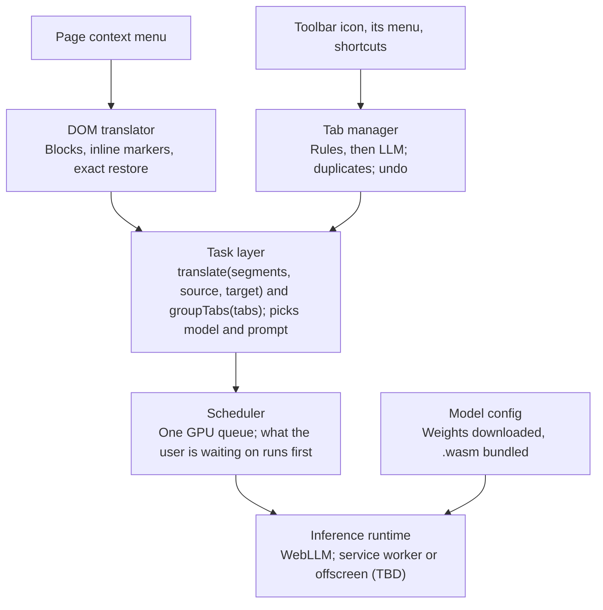

# Architecture

This is the current design and is kept up to date as it changes. The reasoning behind it is in [discovery-brief.md](discovery-brief.md). Module names, file layout and APIs are still open until discovery settles them.

## Module boundaries

The features are separated from inference so the runtime and the model can change without touching feature code. Only the inference runtime knows about WebLLM.

- Requests flow down from the browser surfaces (page context menu, toolbar icon and its menu, keyboard shortcuts).
- The DOM translator only sends text segments and receives translations. It never sees a model.
- The task layer turns feature requests into prompts and picks the model.
- The scheduler runs one GPU queue, so what the user is waiting on goes first.
- The model list is configuration. A fine-tuned or newer model is a config change.

## Open

- Whether the inference runtime lives in the service worker or an offscreen document. [discovery.md](discovery.md) recommends an offscreen document running WebLLM in a dedicated worker, pending measurement.
