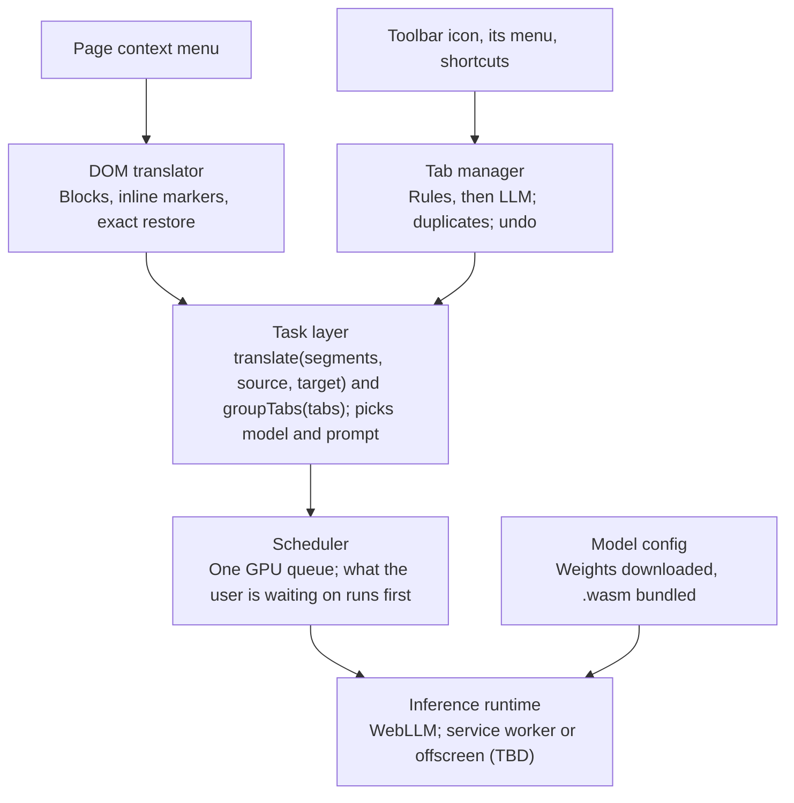

# Nook — Discovery Brief

Nov 26, 2026 · @Justin Chapdelaine

## How to use this brief

This is starting context for discovery, not an implementation plan. It records what was decided during an exploratory conversation and why, what we learned, and what is still open.

Your job as the agent:

1. Read it and verify anything that may have changed. Library versions, model availability and browser behaviour move fast; facts here were checked on 2026-11-26.
2. Research the open questions and run small experiments where that is the only way to answer them.
3. Then write the actual plan with the owner.

Treat **locked decisions** as fixed unless you find a concrete reason they can't work; if so, raise it rather than routing around it. Everything else, including file structure, libraries beyond WebLLM, prompts and build tooling, is yours to propose.

## What Nook is

Nook is a Chromium browser extension that adds quality-of-life features powered by AI running entirely on the user's machine through WebGPU. Page content never leaves the device.

- **Page translation:** translate a selection or a whole page in place (Google Translate-style, preserving links and layout). The main reason to build this rather than use an existing tool: offline translators today (e.g. Firefox's Bergamot, used by [Linguist](https://github.com/translate-tools/linguist)) support few languages.
- **Tab grouping:** organise open tabs into named, coloured native tab groups.
- **Duplicate tabs:** find and close exact duplicates, later near-duplicates.

Target browser: [Helium](https://helium.computer/) first (built on ungoogled-chromium), with other Chromium browsers kept possible. Working name: Nook. Likely published to the Chrome Web Store eventually.

The owner has built a previous extension running local models with Transformers.js and WebGPU, using a hidden page to keep the model alive. WebGPU working in this environment does not need re-proving.

## Principles

- **Local only.** Inference happens on the device. Downloading model files is the only network use, and the UI should make that distinction clear.
- **Unobtrusive.** Features live in context menus, the toolbar icon and keyboard shortcuts. Popups and panels are a last resort.
- **AI is optional.** Deterministic code handles everything it can; duplicate detection and rule-based grouping work with no model loaded.
- **Reversible.** Tab moves, closes and page translations can always be undone or restored.
- **User work first.** When work competes for the GPU, what the user is waiting on goes first, such as visible blocks before the rest of the page.
- **Modular.** The inference runtime and the model are swappable without touching feature code.
- **Modern stack.** Prefer current tooling and web platform features, checked against what Helium actually supports.

## Locked decisions

| Decision | Why |
| --- | --- |
| [WebLLM](https://github.com/mlc-ai/web-llm) is the only inference runtime for now | Built for LLMs: OpenAI-style API, JSON-constrained output, official Chrome extension examples. Transformers.js v4 is comparable in speed but was set aside to keep one runtime. |
| No cloud translation APIs, including Google Cloud Translation | Page text would leave the device, which defeats the product. The paid API also needs per-user keys. |
| Translation is LLM-based, not a dedicated translation model | Language coverage is the goal; WebLLM runs only LLMs (no encoder-decoder models such as NLLB). |
| The final model is not chosen yet | Qwen3.5-2B is the stand-in, 0.8B the light option. Better translation models may appear; the model list lives in config, not code. |
| Controls are the page context menu, the toolbar icon and its context menu, and keyboard shortcuts, plus minimal in-page feedback (selection bubble, progress indicator) | Unobtrusive. Panels or popups only where nothing else works. |
| Chrome Web Store-ready from the start | Likely future distribution. Affects permissions, remote code and how the offscreen document is justified. |
| Helium is the first browser to validate on | The owner's browser; it may lag Chrome and lacks Google-dependent features. |
| Embeddings are deferred; tab grouping uses rules plus the LLM | One model to download and keep alive. WebLLM's current embedding models may be English-focused. |

## Known constraints and gotchas

**Models and runtime**

- Qwen3.5 is in the [WebLLM catalogue](https://webllm.mlc.ai/models/): `Qwen3.5-0.8B-q4f16_1-MLC` \~1.6 GB VRAM, `Qwen3.5-2B-q4f16_1-MLC` \~2.2 GB, both at a **4K context** in those builds (the model itself supports far more; check whether it can be raised).
- Qwen3.5 uses a new hybrid architecture (Gated DeltaNet + attention), so its WebLLM support is recent. If output or speed looks wrong, compare against an established model such as Qwen3 to separate model issues from extension issues.
- `q4f16` needs the `shader-f16` GPU feature; fall back to `q4f32` where it is missing.
- [Custom models](https://github.com/mlc-ai/web-llm#custom-models) need weights plus a compiled `model_lib` `.wasm`. Fine-tunes of a supported architecture can reuse the existing library.

**Extension platform**

- WebGPU works in extension service workers since Chrome 124, but the browser can terminate the worker at any time; WebLLM's heartbeat is not a guarantee. An offscreen document (the MV3 form of the owner's current hidden page) may be the more reliable home.
- **Remotely hosted code:** the Web Store counts JS and Wasm loaded from outside the package as [remote code](https://developer.chrome.com/docs/extensions/develop/migrate/remote-hosted-code). Model weights are data and can be downloaded; `model_lib` `.wasm` files must ship inside the extension.
- Chrome extensions cannot add items to the tab strip or tab right-click menu.
- Helium is based on ungoogled-chromium, so Chrome's built-in Translator API and Gemini Nano are very likely unavailable.

**Page safety and fidelity**

- Model output must never be inserted as HTML; translated text goes into text nodes only.
- Restoring the original must not rebuild elements from saved `innerHTML`, which drops event listeners and breaks framework state. Keep the original nodes and swap text.
- Small models drop or reorder inline-tag markers; output needs validation and a fallback.
- Total translation time is the real cost, not context size: chunking spreads the work out but doesn't reduce it.

## Feature direction

This describes what we want each feature to do, not how to build it.

**Translation**

- Context menu entries along the lines of: *Translate selection*, *Translate page*, *Show original*. Translation goes into the browser's language (chrome.i18n.getUILanguage), changeable once on the options page; no language submenu. Labels can reflect the detected page language, and the page entry hides or says so when the page is already in the target language.
- Selection results appear in a small floating bubble isolated from page styles.
- Full pages translate block by block (paragraphs, headings, list items, cells), visible content first, with cancellation. Progress: only the blocks currently being translated pulse gently in opacity, then cross-fade to the translation; users with reduced motion get a static dim instead. A small corner indicator shows overall progress and offers cancel. No placeholder shapes: they hide the original while waiting and shift the layout.
- Short blocks are batched together; neighbouring text or the page title can be passed as reference for consistent names and terms. Very long blocks are split into sentences.
- Inline formatting and links survive translation; code, form fields and similar content are skipped.
- Restoring the original is instant and exact. Dynamic pages that re-render need handling.
- Use `chrome.tabs.detectLanguage` / `chrome.i18n.detectLanguage` (local) for menu labels, skipping blocks already in the target language, and telling the model the source language.
- Later: per-site auto-translate. No bilingual mode.

**Tab grouping**

- Triggered by clicking the toolbar icon, a keyboard shortcut, or the toolbar icon's context menu (*Group tabs*, *Close duplicates*, *Undo last change*, *Settings*).
- Rules handle obvious cases (same site, URL patterns); one LLM request places the rest and names all groups. Refer to tabs by short indexes and validate the result.
- When triggered, groups are applied immediately with undo; a review-before-applying mode would be the one justified panel, if wanted.
- Grouping only happens when the user asks. Tabs never move on their own, including newly opened ones.

**Duplicates**

- Exact duplicates via URL normalisation (tracking parameters, canonical URLs), deterministic and model-free, keeping the active or oldest tab, with undo.
- Later: near-duplicates by comparing page content.

**Setup and settings**

- The first model download (1–2 GB) needs explicit consent and a progress display. An options page holds the target language, model choice, site exclusions and cache management.

## Architecture direction

The features are separated from inference so the runtime and model can change without touching feature code. These boundaries are the intent; names, file layout and APIs are open.

Only the runtime module knows about WebLLM:

Requests flow down from the browser surfaces. Only the inference runtime talks to WebLLM, and the model list is configuration, so a fine-tuned or newer model is a config change. The DOM translator only sends text segments and receives translations; it never sees a model.

## Open questions for discovery

- [ ] **Hosting:** service worker or offscreen document? Measure model load, behaviour after idle, recovery after the worker is killed, and sharing one engine across features.
- [ ] **Translation speed:** seconds per screen of translated text on the owner's hardware, for 2B and 0.8B. This decides whether full-page translation feels usable.
- [ ] **Qwen3.5 in WebLLM:** is it stable, and does `enable_thinking: false` (or its current equivalent) work?
- [ ] **Context window:** can the 4K default be raised, and at what memory cost?
- [ ] **Translation quality:** is 0.8B good enough, or is 2B the floor? Test across several languages, including less common ones.
- [ ] **Inline tags:** which marker format survives best, and what should the fallback be?
- [ ] **Batching:** block group sizes and how much reference context gives good results without slowing things down.
- [ ] **Helium:** confirm WebGPU in workers or offscreen documents, `tabGroups`, `contextMenus`, `commands` and `detectLanguage`.
- [ ] **Bundled `.wasm`:** confirm WebLLM loads `model_lib` from the extension package, and how large those files are.
- [ ] **Minimum permissions:** the smallest set for each feature; whether host permissions can be optional.
- [ ] **Build tooling:** Vite, WXT or similar for a multi-entry MV3 build.
- [ ] **Candidate models:** anything newer or translation-tuned worth testing, built in or as a custom model.

## Suggested phases

A starting order, not a commitment; each phase is defined by what's true when it's done.

1. **Proof of concept.** Done when Qwen3.5 runs through WebLLM inside a minimal extension in Helium, we have measured numbers for load time, memory, tokens per second and seconds per translated screen, we know which host (service worker or offscreen document) to use and how recovery after termination works, and `model_lib` loads from the package.
2. **Foundation and model-free tab tools.** Done when the module boundaries exist, and exact duplicate closing and rule-based grouping work with undo and no model loaded.
3. **Selection translation.** Done when the context menu translates a selection into a floating bubble, streamed, with language detection, and quality has been checked on realistic text.
4. **AI tab grouping.** Done when one LLM request groups the remaining tabs and names the groups reliably on a 20–50 tab window, with undo.
5. **Full-page translation.** Done when pages translate in place, visible content first, with links and formatting kept, exact restore, cancellation, and acceptable results on articles, docs and dynamic sites.
6. **Polish and store readiness.** Done when model download and settings are smooth, permissions are minimal and justified, and the extension passes a Web Store review checklist. Per-site auto-translate and near-duplicates fit here or later.

## Rejected or deferred

| Option | Status | Reason |
| --- | --- | --- |
| Google Cloud Translation / free Google endpoint | Rejected | Text leaves the device; the free endpoint isn't covered by the Cloud privacy terms. |
| Bergamot (Firefox Translations) | Rejected | Fast, but too few languages; the main reason for this project. |
| NLLB-200 via Transformers.js | Rejected for now | 200 languages, but sentence-level, no inline tags, research-oriented licence, and a second runtime. |
| TranslateGemma | Watch | Translation-tuned, 4B+ is heavy for browsers; WebLLM support unconfirmed. |
| Transformers.js as a second runtime | Deferred | Possible later behind the runtime interface if a needed model only exists there. |
| Embedding models for tab clustering | Deferred | Possibly useful later for 100+ tab windows and near-duplicate detection. |
| Chrome built-in AI (Translator API, Gemini Nano) | Not available | Likely absent in Helium; can be feature-detected. |
| Tab-strip context menu | Not possible | Chromium doesn't expose it to extensions. |
| Popups and side panels as the main UI | Rejected | Conflicts with the unobtrusive principle. |
| An optional cloud translator for non-sensitive pages | Deferred | Not in version 1; the translator interface leaves room for it. |
| Bilingual translation mode | Rejected | Not wanted; translation only swaps text in place. |
| Automatic grouping of newly opened tabs | Rejected | Tabs moving on their own is jarring; grouping only on request. |
| Target-language submenu | Rejected | Browser language by default, one setting to change it. |
| Placeholder shapes while translating | Rejected | They hide the original and shift the layout; a gentle pulse is used instead. |

## What we want back

1. A short list of anything in this brief that is outdated or wrong, with sources.
2. Answers or experiment plans for each open question.
3. A draft implementation plan for review: architecture, project setup, phase breakdown with done-when criteria, and the risks you see.

Tooling: install the [Modern Web Guidance](https://developer.chrome.com/blog/modern-web-guidance-v1) skills, including its Chrome extensions skill, and use them for extension and in-page UI work.

## References

- [WebLLM](https://github.com/mlc-ai/web-llm) and its [model catalogue](https://webllm.mlc.ai/models/)
- [WebLLM Chrome extension example](https://github.com/mlc-ai/web-llm/tree/main/examples/chrome-extension) and [service-worker example](https://github.com/mlc-ai/web-llm/tree/main/examples/chrome-extension-webgpu-service-worker)
- [WebLLM custom models](https://github.com/mlc-ai/web-llm#custom-models)
- [Extension service worker lifecycle](https://developer.chrome.com/docs/extensions/develop/concepts/service-workers)
- [Remotely hosted code](https://developer.chrome.com/docs/extensions/develop/migrate/remote-hosted-code) and [MV3 store requirements](https://developer.chrome.com/docs/webstore/program-policies/mv3-requirements)
- [Tab groups API](https://developer.chrome.com/docs/extensions/reference/api/tabGroups) and [tabs API](https://developer.chrome.com/docs/extensions/reference/api/tabs)
- [Linguist](https://github.com/translate-tools/linguist) (BSD-3; reference for DOM translation)
- [Helium](https://helium.computer/)
